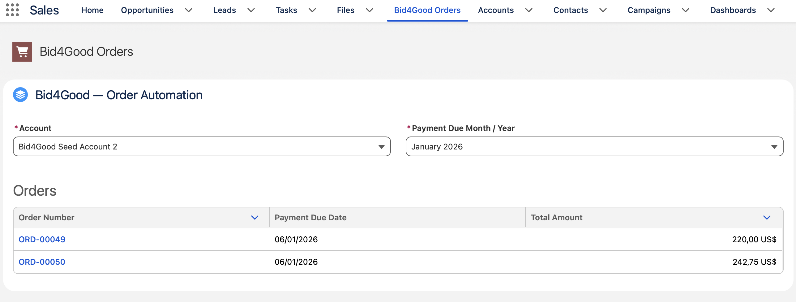
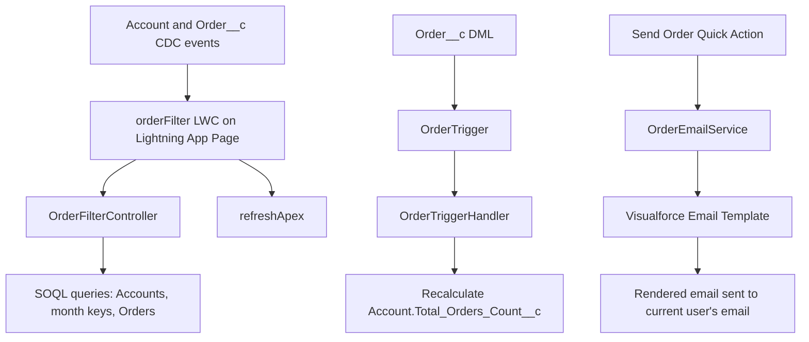
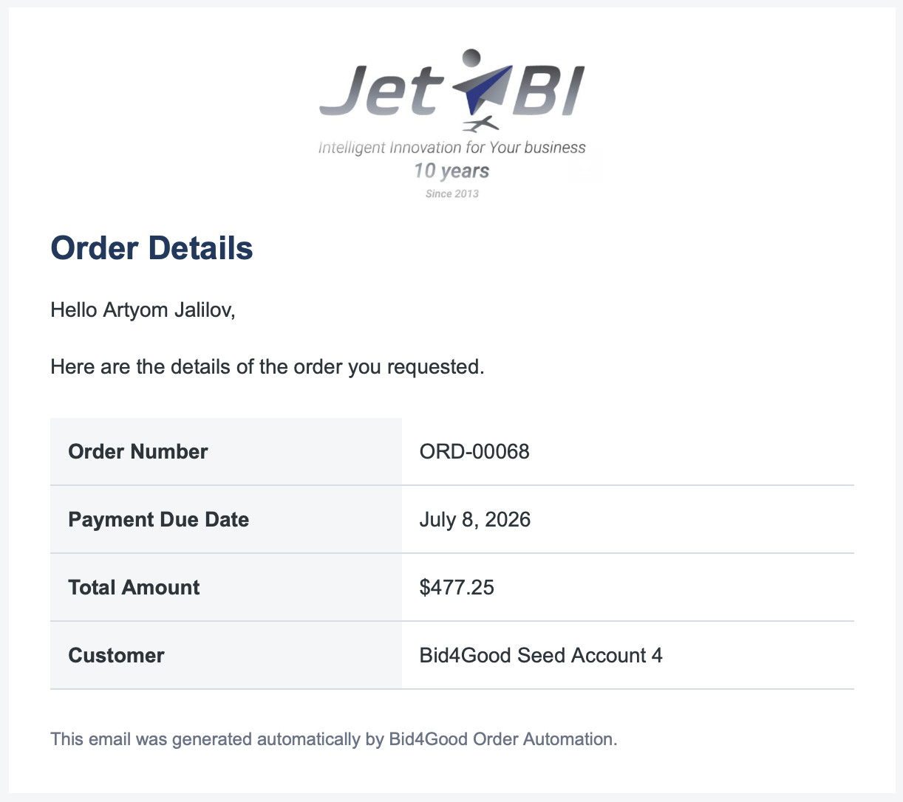

# Bid4Good Order Automation

A Salesforce DX learning project that automates order-count aggregation, provides an Account/month-based custom order explorer, and sends order notification emails from an Order__c record.

> **Project context:** Created as a Salesforce Developer course final assignment. Email delivery and real-time updates depend on org-level configuration described below.

## Overview

The project includes:

- A custom `Order__c` object related to `Account` through an optional Lookup.
- An Apex trigger and handler that maintain `Account.Total_Orders_Count__c` after Order__c insert, reassignment, deletion, and undelete.
- A Lightning Web Component (LWC) with Account and Payment Due Month/Year filters and a clickable orders table.
- Change Data Capture (CDC) subscriptions for Account and Order__c changes, refreshing the wired Apex data without a manual browser refresh. Supports CDC-based refresh when enabled and configured in the org.
- A `Send Order` Lightning Web Component Quick Action that renders a Visualforce Email Template and sends the order details to the current Salesforce user.
- Test-data utilities and an Anonymous Apex seed script for local demonstration.

## Order Filter UI

The `orderFilter` LWC is placed on a Lightning App Page. Select an Account to see the months available for its orders, then select a month to view matching Order records. Clicking an order number opens the standard Salesforce record page.



## Data Model

### `Order__c`

| Field                      | API name              | Type                            | Rules                   |
| -------------------------- | --------------------- | ------------------------------- | ----------------------- |
| Order Number (record name) | `Name`                | Auto Number, e.g. `ORD-{00000}` | Generated by Salesforce |
| Total Amount               | `Total_Amount__c`     | Currency, 2 decimal places      | Required                |
| Payment Due Date           | `Payment_Due_Date__c` | Date                            | Required                |
| Account                    | `Account__c`          | Lookup to Account               | Optional                |

### `Account`

| Field              | API name                | Type                     | Purpose                                                  |
| ------------------ | ----------------------- | ------------------------ | -------------------------------------------------------- |
| Total Orders Count | `Total_Orders_Count__c` | Number, 0 decimal places | Number of related `Order__c` records; maintained by Apex |

`Total_Orders_Count__c` should be read-only for users who must not edit the derived value manually. Field-Level Security and Page Layout settings are separate configuration layers; administrator permissions may intentionally allow overrides.

## Architecture



### Apex trigger

`OrderTrigger` delegates to `OrderTriggerHandler`. The handler recalculates counts in bulk and accounts for:

- `after insert`
- `after update` when `Account__c` changes
- `after delete`
- `after undelete`
- Orders with a null `Account__c`
- Accounts whose last related Order is removed

### Lightning Web Component

`orderFilter` uses standard `lightning-combobox` controls and `lightning-datatable`. Its Apex controller exposes three cacheable read methods:

- `getAccountsWithOrders()`
- `getAvailableMonthKeys(accountId)`
- `getOrdersForAccountAndMonth(accountId, monthKey)`

Month keys use `YYYY-MM` to keep the same calendar month in different years distinct. CDC events are used as signals to refresh Apex wire results, rather than as the source of the full table data.

### Email automation

The `Send Order` headless LWC Quick Action calls `OrderEmailService`. The service renders the `Bid4Good_Order_Email` Visualforce Email Template with the current User and the selected `Order__c`, then sends the rendered content to `UserInfo.getUserEmail()`.

The email uses the externally accessible JetBI logo URL stored in the `JetBI_Logo_Public_URL` Custom Label. The sender is configured separately with an Organization-Wide Email Address (OWEA). Successful submission to Salesforce does not guarantee final delivery; the sender domain must pass the recipient's email authentication checks.



## Repository Layout

```text
force-app/main/default/
├── classes/
│   ├── OrderEmailService.cls
│   ├── OrderEmailServiceTest.cls
│   ├── OrderFilterController.cls
│   ├── OrderFilterControllerTest.cls
│   ├── OrderTriggerHandler.cls
│   ├── OrderTriggerTest.cls
│   └── TestDataFactory.cls
├── email/
│   └── unfiled$public/
│       └── Bid4Good_Order_Email.email
├── lwc/
│   ├── orderFilter/
│   └── sendOrderHeadlessAction/
├── objects/
│   ├── Account/
│   └── Order__c/
└── triggers/
    └── OrderTrigger.trigger

scripts/apex/seedData.apex
docs/images/order-filter-app.png
docs/images/order-notifications-email.png
```

Salesforce metadata sidecar files (`*-meta.xml`) and any additional metadata in the repository are omitted from this overview for readability.

## Requirements

- A Salesforce org with permission to deploy Apex, custom objects, LWC, Visualforce Email Templates, and related metadata.
- Salesforce CLI (`sf`) and Visual Studio Code with the Salesforce Extension Pack.
- CDC enabled for `Account` and `Order__c`.
- A configured sender address and email authentication for outbound email.
- A publicly reachable HTTPS URL for the JetBI logo.

`lightning/empApi` is intended for Lightning Experience in a supported desktop browser. Verify org permissions for subscribing to CDC channels and reading the objects and fields used by the Apex controller.

## Setup and Deployment

### 1. Clone and authorize an org

```bash
git clone <your-repository-url>
cd bid4good-order-automation
sf org login web --alias bid4good-dev --set-default
```

If the project uses a different org alias, replace `bid4good-dev` in the commands below.

### 2. Deploy Salesforce metadata

```bash
sf project deploy start \
  --source-dir force-app/main/default \
  --target-org bid4good-dev
```

Resolve any org-specific metadata dependencies before deploying to a new org.

### 3. Configure the logo

1. Upload the JetBI logo to Salesforce using the approved image-hosting approach for the org (for example, a Document configured for external image availability).
2. Verify that the image URL can be fetched by a recipient who is not logged in to Salesforce.
3. Set the `JetBI_Logo_Public_URL` Custom Label to the public HTTPS image URL.
4. Set `JetBI_Website_URL` to the intended website URL if the logo in the email template links to the company site.

Do not store credentials or private access tokens in Custom Labels or the repository.

### 4. Configure email sending

1. Create and verify an Organization-Wide Email Address with the intended display name, such as `Bid4Good Notifications`.
2. Configure sender-domain authentication as applicable (DKIM, SPF, and DMARC, including DNS changes when required).
3. Confirm the org's Deliverability settings permit outbound email.
4. Ensure `OrderEmailService` selects the intended OWEA address rather than an arbitrary record.
5. Test a message and inspect Salesforce Email Logs if delivery fails.

OWEA controls the configured sender identity; it does not by itself guarantee DKIM authentication or inbox delivery. Use only a sender address/domain you are authorized to use.

### 5. Enable Change Data Capture

In Setup, open **Change Data Capture** and select both `Account` and `Order__c`. Confirm that users who need live updates have the required object access and permissions for CDC subscriptions.

### 6. Add the UI components

- Create or activate a Lightning App Page and place the `orderFilter` component on it.
- Add the page to the navigation of the intended Lightning app.
- Create the `Send Order` action using `sendOrderHeadlessAction` on the `Order` object, then add it to the applicable Lightning actions on the Order Page Layout or Dynamic Actions configuration.

## Demo Data

The script `scripts/apex/seedData.apex` creates or reuses five dedicated Accounts named `Bid4Good Seed Account 1` through `Bid4Good Seed Account 5`, then inserts 40 `Order__c` records (eight per Account). Due dates are unique, and each Account has orders across eight consecutive months; the start month differs by Account so that the month filter can be demonstrated.

Run it from the project root:

```bash
sf apex run \
  --file scripts/apex/seedData.apex \
  --target-org bid4good-dev
```

> **Warning:** Every run deletes existing `Order__c` records linked to those five dedicated seed Accounts before recreating the demo Orders. Run this script only in a development/demo org. Do not reuse these Account names for real data.

`TestDataFactory` is separate from the seed script: it creates isolated records for Apex tests and should not depend on pre-existing org data.

## Tests

The `OrderTriggerTest` class exercises the derived Account count for insert, reassignment, delete, undelete, an Order without an Account, clearing/reassigning the optional Lookup, amount-only updates, and bulk insert.

Run the trigger test class with Salesforce CLI:

```bash
sf apex run test \
  --class-names OrderTriggerTest \
  --target-org bid4good-dev \
  --result-format human
```

Run the broader test suite before deploying a release. The course assignment requires at least 80% Apex code coverage; verify the actual deployment coverage and behavior in the target org rather than relying on a single test class alone.

## Notes

- The project is intended for learning and demonstration; review security, sender configuration, error handling, and operational requirements before adapting it for production.
- Never commit org authentication files, secrets, or private tokens.
- When deploying to another org, reconfigure the public logo URL, sender address, DKIM/domain settings, CDC selection, and any org-specific permissions.
